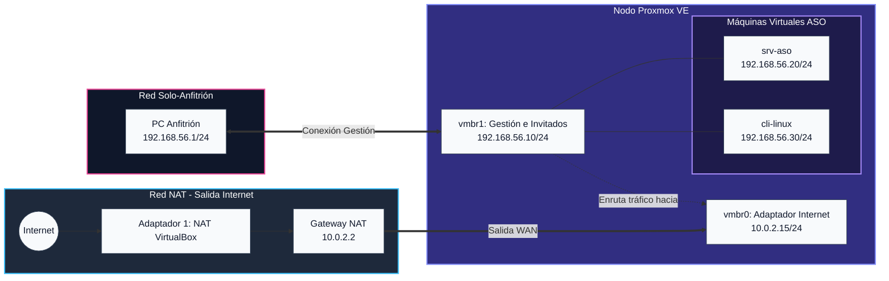

# 02-diagrama-red

## Objetivo
Diseñar la red que utilizaremos en nuestro Laboratorio de Proxmox: identificando el nodo Proxmox, el servidor ASO y el cliente ASO; realizando todo esto antes de la instalacion de Proxmox

## Procedimiento
- En esta tabla se muestra como sera la jerarquia de red de nuestro laboratorio Proxmox:

| Elemento | Nombre | IP | Funcion |
|---|---|---|---|
| VirtualBox, adaptador 1 | NAT | No asignable | Salida a internet de Proxmox |
| Nodo, vmbr0 sobre adaptador 1 | Adaptador internet | 10.0.2.15/24 | Salida a internet del nodo |
| Gateway NAT de VirtualBox | No asignable | 10.0.2.2 | Salida a internet del servidor y cliente ASO |
| Virtualbox, interfaz solo-anfitrion | Adaptador VM-anfitrion | 192.168.56.1/24 | Permitir conexion entre maquina virtual y el ordenador |
| Nodo, vmbr1 sobre adaptador 2 | No asignable | 192.168.56.10/24 | Gestion del nodo y gateway de invitados |
| srv-aso en vmbr1 | No asignable | 192.168.56.20/24 | Adaptador server ASO |
| cli-linux en vmbr1 | No asignable | 192.168.56.30/24 | Adaptador cliente ASO |

- Y ahora mostrare un diagrama visual donde veremos la planificacion de la red

[Volver al indice](../README.md)
