# 03-instalacion-proxmox

## Objetivo
Configurar la maquina virtual de Proxmox e instalar Proxmox en ella

## Procedimiento y Evidencias
### Comprobar anfitrion
El proceso de investigacion de la maquina anfitrion ya lo realice en el ejercicio anterior de manera bastante detallada. Para acceder a el puede usar este enlace: [Inventario](01-inventario-hardware.md)

### Crear VM exterior
Primero crearemos la maquina virtual de Proxmox, insertando los parametros en la maquina que ya indicamos en la practica anterior de [inventariado](01-inventario-hardware.md).

- Nombre maquina virtual, Info del S.O y ISO utilizada
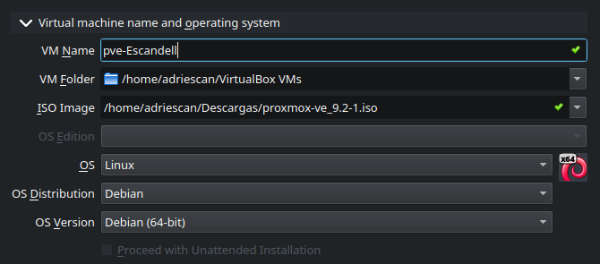

- Asignacion de RAM y vCPU

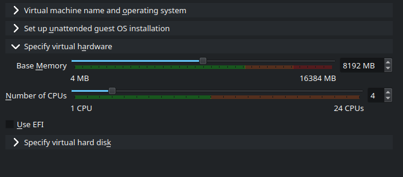

Justificacion mayor tamaño vCPU: en mi caso asigno mas de dos vCPU ya que, el equipo que voy a utilizar (indicado en la practica anterior de [inventariado](01-inventario-hardware.md)); cuenta con suficientes recursos como para ampliar un poco mas la cantidad de vCPU

- Creacion de disco virtual

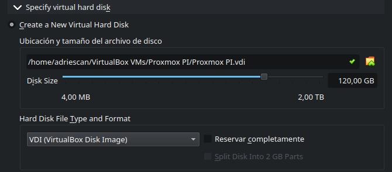

### Configuracion de interfaces de red
Tendiendo la maquina creada, configuraremos las interfaces de red de nuestra maquina Proxmox, siguiendo el esquema de red que hicimos en la anterior practica [Diagrama de red](02-diagrama-red.md). Dejaremos una interfaz en NAT y la otra la configuraremos como una interfaz Host-Only

**NAT**

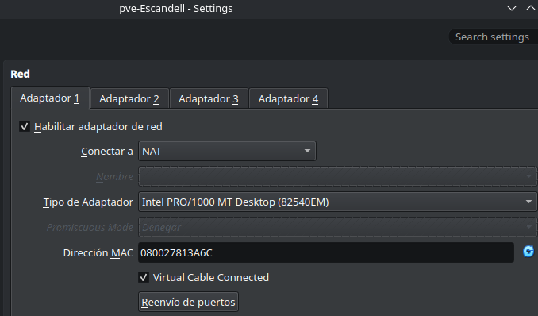

**Host-Only**

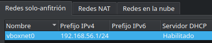

(Aunque el adaptador tenga DHCP habilitado, en nuestra maquina le asignaremos un IP fija; que eso se realizara mas adelante)

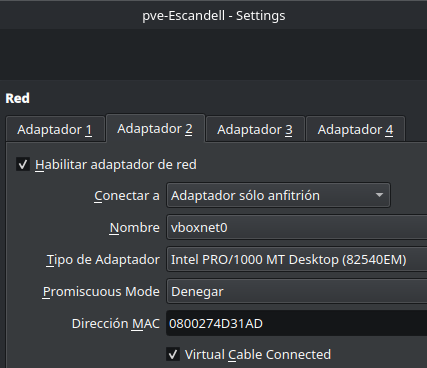

### Comprobar virtualizacion anidada
Ahora comprobaremos que podemos activar la virtualizacion anidada en nuestra maquina virtual. Esto esta indicado como Nested-VTx/AMD-V; que en mi caso si lo he podido activar
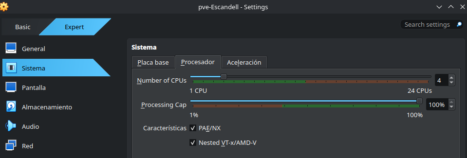

Tambien deberemos tener activada otra opcion llamada "Hardware Virtualization" para poder tener un mejor rendimento de virtualizacion en nuestra maquina virtual. En mi caso, puede activar esta opcion sin problema
]

### Instalacion Proxmox
Al tener ya todo configurado perfectamente, inciaremos la instalacion de proxmox. Primero indicaremos el disco donde instalaremos Proxmox (en nuestro caso, el VDI que creamos antes)
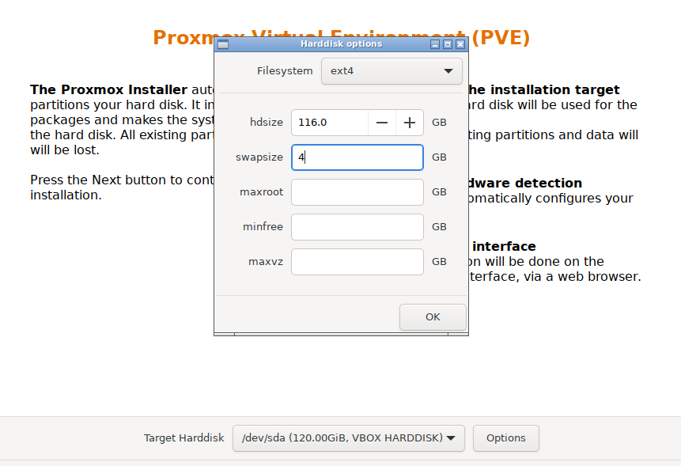

(Entre la configuracion del disco y la red, se configuran otros parametros como la region y la contraseña que usaremos; pero no lo vi interesante como para añadir capturas. Ademas en el resumen final vemos un poco esta configuracion)

Luego configuraremos la interfaz de red tal y como indicamos en nuestro [diagrama de red](02-diagrama-red.md) del ejercicio anterior(cuando este instalado, tendremos que configurar la de host-only)
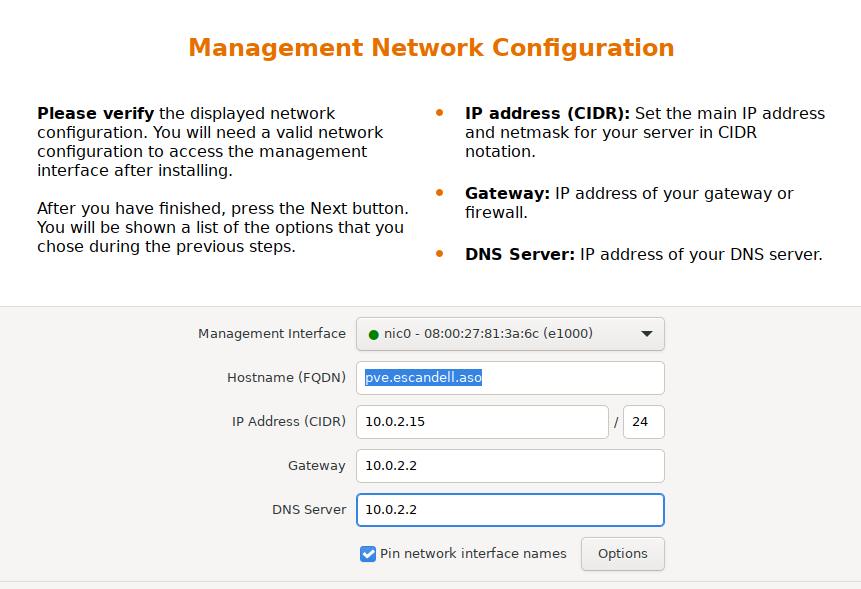

Y aqui un resumen de la configuracion que se ha puesto en Proxmox:


### Configuraciones posteriores y comprobacion de que funciona
Al terminal la instalacion de Proxmox, tendremos que configurar la interfaz Host-Only desde su archivo de configuracion, tal como indicamos en nuestro [diagrama de red](02-diagrama-red.md); para poder acceder a Proxmox desde la web (que en mi caso, la interfaz Host-Only es la nic1)
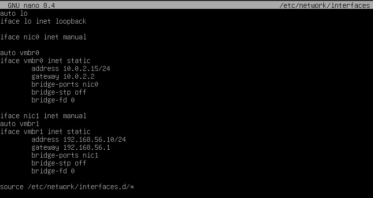

### Comprobacion de acceso a red
Por ultimo, comprobaremos que mediante la IP que acabamos de configurar podemos acceder a nuestro Proxmox desde la web
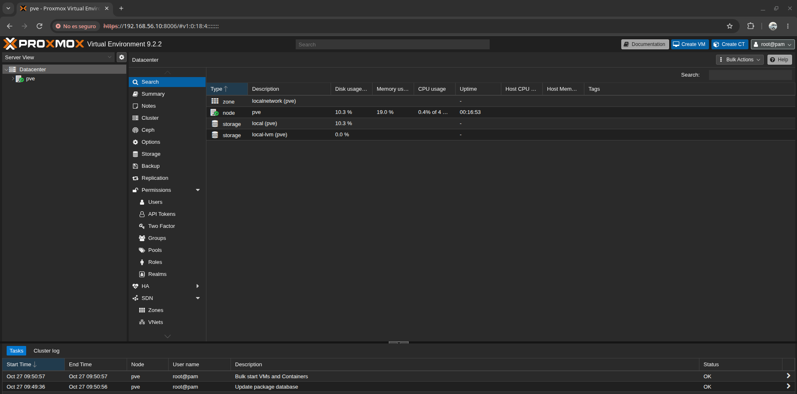

## Comandos usados
**Configuracion de red**
```bash
nano /etc/network/interfaces/
```

## Incidencias
No llego a ocurrir ninguna incidencia durante la instalacion

[Volver al indice](../README.md)
