# 03-instalacion-proxmox

## Objetivo
Configurar la maquina virtual de Proxmox e instalar Proxmox en ella

## Procedimiento y Evidencias
### Comprobar anfitrion
El proceso de investigacion de la maquina anfitrion ya lo realice en el ejercicio anterior de manera bastante detallada. Para acceder a el puede usar este enlace: [Inventario](01-inventario-hardware.md)

### Crear VM exterior
Primero crearemos la maquina virtual de Proxmox, insertando los parametros en la maquina que ya indicamos en la practica anterior de [inventariado](01-inventario-hardware.md).

- Nombre maquina virtual, Info del S.O y ISO utilizada
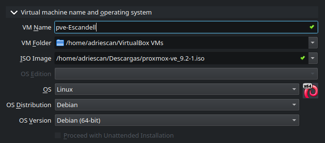

- Asignacion de RAM y vCPU

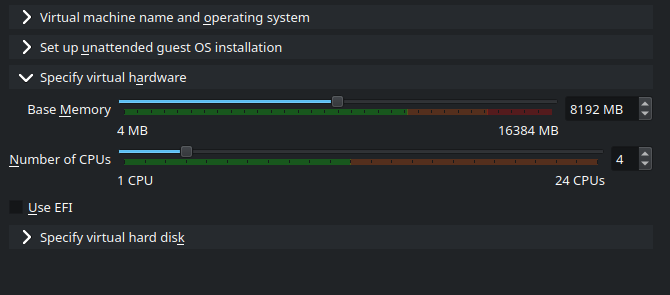

Justificacion mayor tamaño vCPU: en mi caso asigno mas de dos vCPU ya que, el equipo que voy a utilizar (indicado en la practica anterior de [inventariado](01-inventario-hardware.md)); cuenta con suficientes recursos como para ampliar un poco mas la cantidad de vCPU

- Creacion de disco virtual

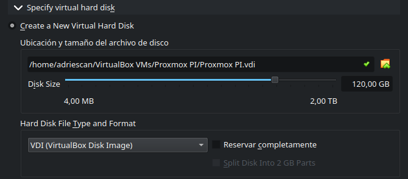

### Configuracion de interfaces de red
Tendiendo la maquina creada, configuraremos las interfaces de red de nuestra maquina Proxmox, siguiendo el esquema de red que hicimos en la anterior practica [Diagrama de red](02-diagrama-red.md). Dejaremos una interfaz en NAT y la otra la configuraremos como una interfaz Host-Only

**NAT**

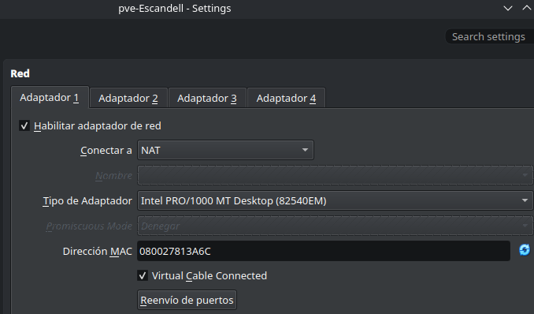

**Host-Only**

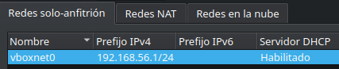

(Aunque el adaptador tenga DHCP habilitado, en nuestra maquina le asignaremos un IP fija; que eso se realizara mas adelante)

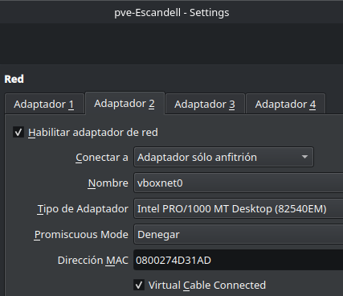

### Comprobar virtualizacion anidada
Ahora comprobaremos que podemos activar la virtualizacion anidada en nuestra maquina virtual. Esto esta indicado como Nested-VTx/AMD-V; que en mi caso si lo he podido activar
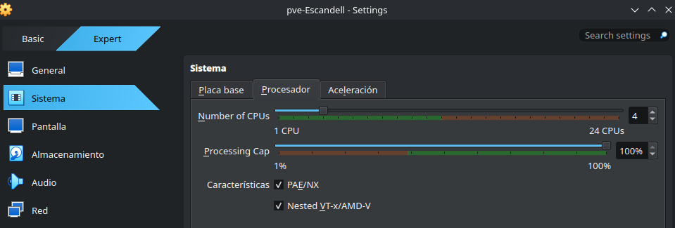

Tambien deberemos tener activada otra opcion llamada "Hardware Virtualization" para poder tener un mejor rendimento de virtualizacion en nuestra maquina virtual. En mi caso, puede activar esta opcion sin problema
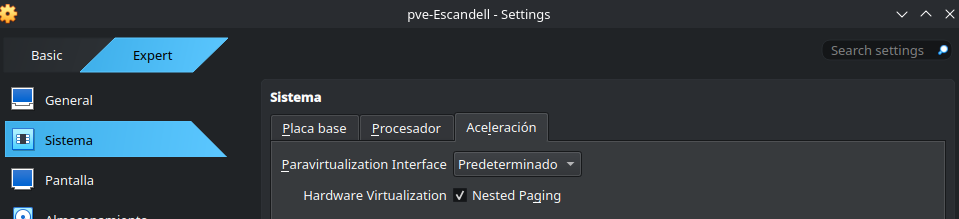]

### Otras configuraciones y mejoras para la VM
Ahora nos fijaremos en otras mejoras que podemos aplicar a nuestra maquina de Proxmox.
Primero activaremos la opcion PAE/NX


Luego cambiaremos la paravirtualizacion de la predeterminada a KVM para mejor funcionamiento de la virtualizacion que albergara nuestra maquina de Proxmox

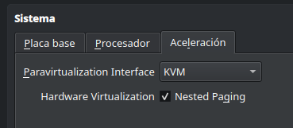

Despues, cambiaremos la interfaz de discos de SATA a virtioscsi y le indicaremos a esa misma interfaz que utilice la cache del I/O anfitrion

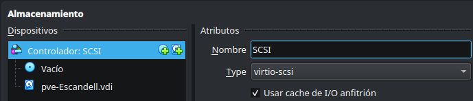

Y por ultimo, cambiaremos la configuracion anterior de disco de 120GBs dinamico; por uno de 80GBs fijo
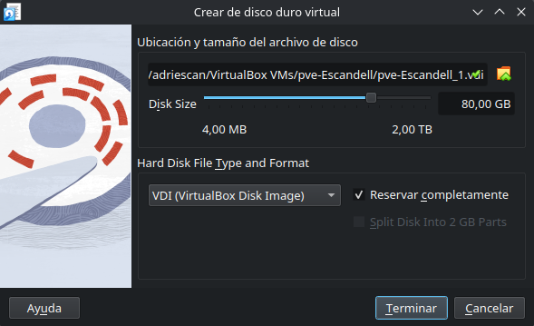
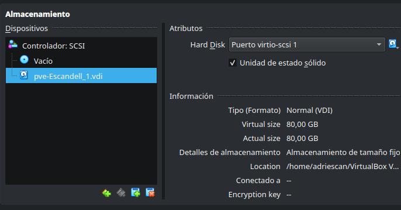

(Yo indique que fuera Unidad de estado solido para mayor velocidad del disco)

### Instalacion Proxmox
Al tener ya todo configurado perfectamente, inciaremos la instalacion de proxmox. Primero indicaremos el disco donde instalaremos Proxmox (en nuestro caso, el VDI que creamos antes)
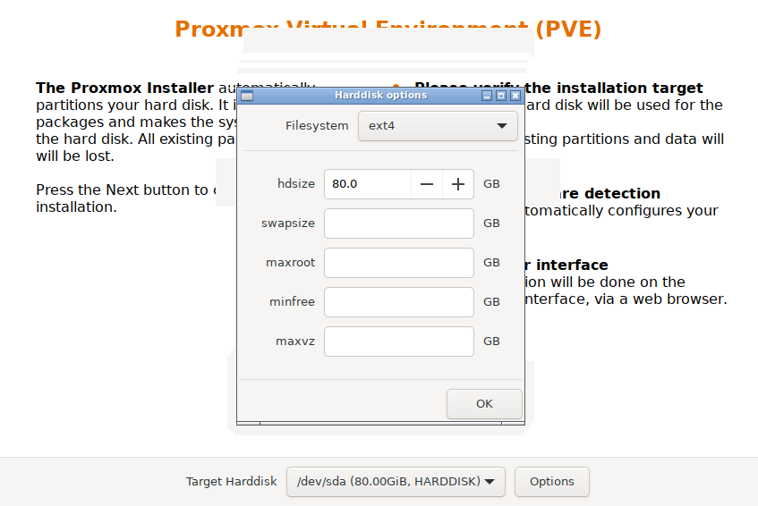

(Entre la configuracion del disco y la red, se configuran otros parametros como la region y la contraseña que usaremos; pero no lo vi interesante como para añadir capturas. Ademas en el resumen final vemos un poco esta configuracion)

Luego configuraremos la interfaz de red tal y como indicamos en nuestro [diagrama de red](02-diagrama-red.md) del ejercicio anterior(cuando este instalado, tendremos que configurar la de host-only)
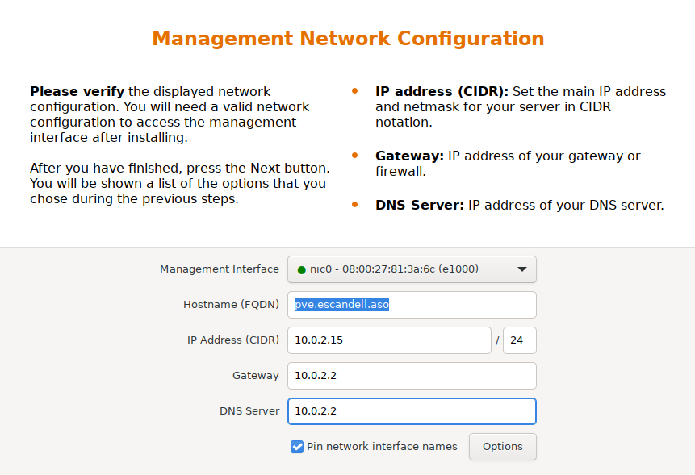

Y aqui un resumen de la configuracion que se ha puesto en Proxmox:
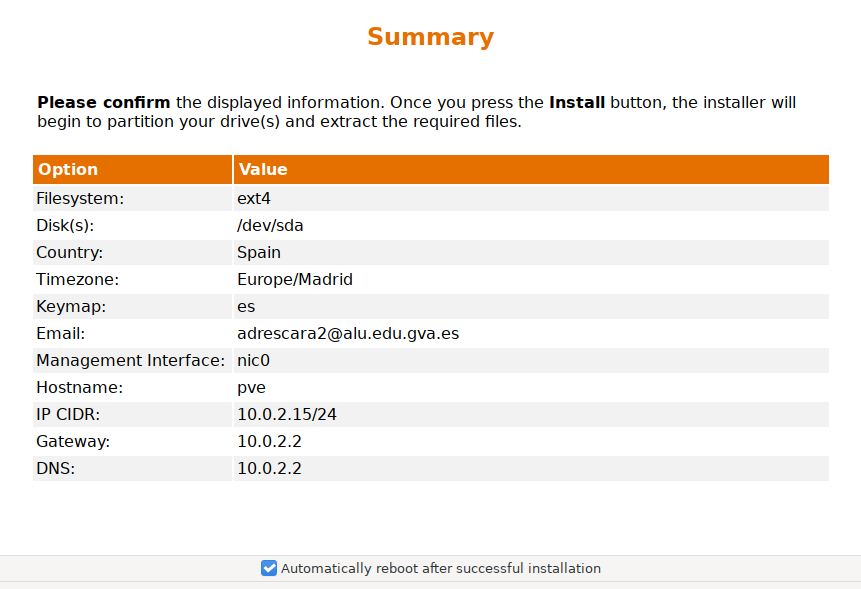

### Configuraciones posteriores y comprobacion de que funciona
Al terminal la instalacion de Proxmox, tendremos que configurar la interfaz Host-Only desde su archivo de configuracion, tal como indicamos en nuestro [diagrama de red](02-diagrama-red.md); para poder acceder a Proxmox desde la web (que en mi caso, la interfaz Host-Only es la nic1)
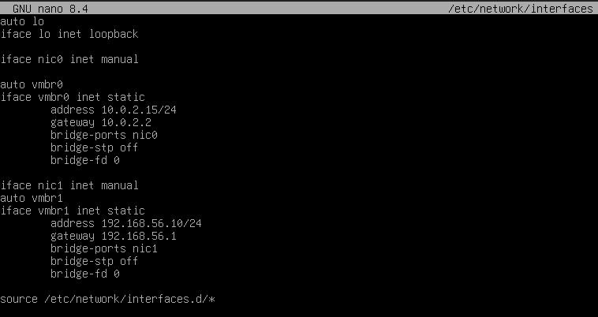

### Comprobacion de acceso a red
Por ultimo, comprobaremos que mediante la IP que acabamos de configurar podemos acceder a nuestro Proxmox desde la web
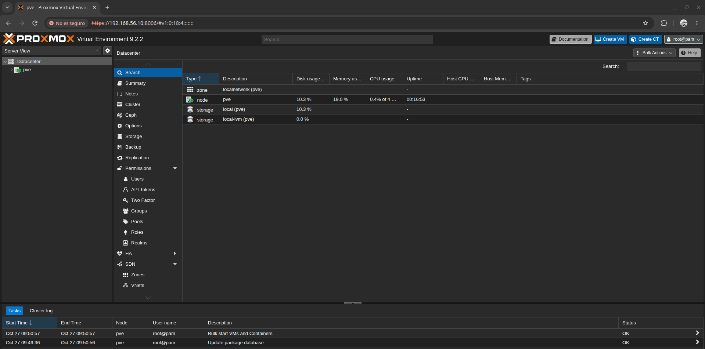

## 03.1 Configuracion del nodo
### Revisar donde se guardaran las cosas
Mediante los comandos mostrados en la captura, veremos como esta repartido el disco y donde se almacenaran las cosas
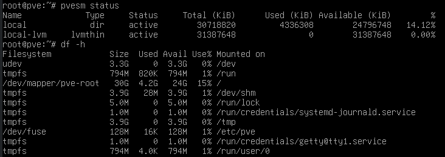

- En la particion local se almacenaran las ISOs, plantillas y copias de seguridad
- En la particion local-lvm se almacenan los VDI de las maquinas
- En la particion pve-root contiene el sistema operativo Proxmox

| Almacenamiento | Capacidad | Utilizado | Disponible |
|---|---|---|---|
| local | 29,37GiB | 4,13GiB | 23,64GiB |
| local-lvm | 29,91GiB | 0GiB | 29,91GiB |
| pve-root | 30GiB | 4,2GiB | 24GiB |

### Comparar configuracion realizada con el diagrama
En este mismo documento muestro como configure la red, en el apartado de Configuraciones posteriores y comprobacion de que funciona
Para compararla con el diagrama que realizamos, puede acceder al documento [Diagrama de red](02-diagrama-red.md)

### Revisar quien puede administrar nodo
Mediante el comando mostrado en la captura de pantalla, se muestran los usuarios que tenemos en nuestro Proxmox; por el momento solo contamos con el usuario creado durante la instalacion
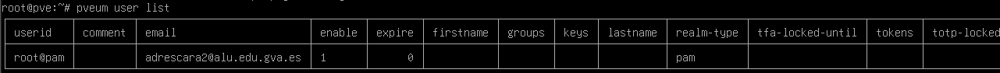

En cuanto el firewall, de momento tampoco se ha aplicado ninguna configuracion, a si que; en esta captura muestro su estado actual
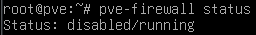

### Ajustar el reparto de recursos
Aqui plasmaremos los cambios finales que tenemos, donde por ejemplo; el disco a sido reducido de tamaño, porque crear un disco fijo de 120GBs era demasiado pesado
| Recurso | CPU/vCPU | Ram | Disco o almacenamiento | Motivo del reparto |
|---|---|---|---|---|
| Proxmox | 4 vCPU | 8 GiB totales | VDI 80 GiB | Recursos totales asignados a Proxmox |
| srv-aso | 2 vCPU | 3 GiB | 18 GiB | Servidor Linux con servicios de red y administración |
| cli-linux | 2 vCPU | 2 GiB | 10 GiB | Cliente Linux para realizar las pruebas |
| Plantilla, ISOs y copias | No aplica | No aplica | Reserva lógica de 10 GiB | Almacenar imágenes y archivos auxiliares |
| Margen de operacion | CPU compartida | 3 GiB dentro de Proxmox; aproximadamente 8 GB fuera para Fedora | |  1,91 GiB en local-lvm y 13,64 GiB en local, antes de nuevos archivos | Evitar agotar completamente el almacenamiento |

(Si quiere ver la anterior reparticion de recursos, esta disponible en [Inventario Hardware](01-inventario-hardware.md)

## Comandos usados
**Configuracion de red**
```bash
nano /etc/network/interfaces/
systemctl restart networking
pvesm status
df -h
pveum user list
pve-firewall status
```

## Incidencias
No llego a ocurrir ninguna incidencia durante la instalacion

## Conclusion
Se tuvo que cambiar el disco antiguo por uno nuevo, debido a que crear un disco de 120GBs fijos era demasiado excesivo

[Volver al indice](../README.md)
